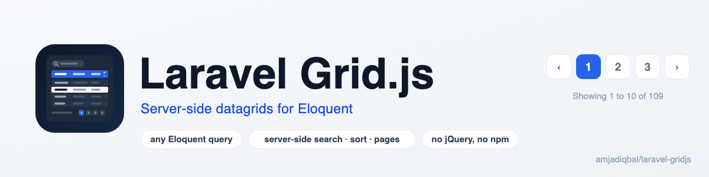
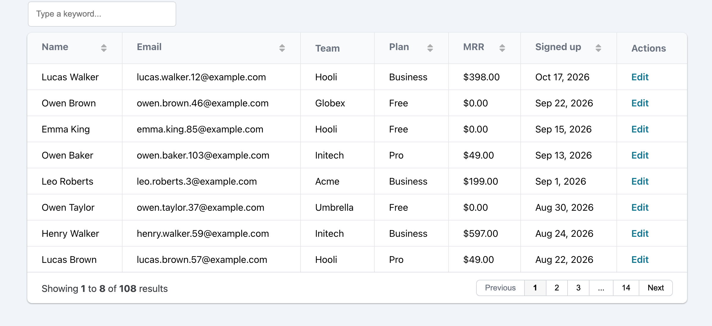

<p align="center">
  <picture>
    <source media="(prefers-color-scheme: dark)" srcset="art/banner-dark.png">
    
  </picture>
</p>

# Laravel Grid.js: server-side datagrid and data table for Eloquent

Turn any Eloquent query into a searchable, sortable, paginated [Grid.js](https://gridjs.io) data table
with one fluent PHP call. Search, sort and pagination run on the server, so a table of a million rows
loads one page at a time. A lightweight DataTables alternative: no jQuery, no npm build step.

[](https://packagist.org/packages/amjadiqbal/laravel-gridjs)
[](https://packagist.org/packages/amjadiqbal/laravel-gridjs)
[](LICENSE.md)

<p align="center">
  
</p>

```php
use AmjadIqbal\GridJS\Facades\Grid;

$customers = Grid::fromQuery(Customer::active()->with('team')->latest('signed_up_at'))
    ->columns([
        'name',
        'email',
        ['field' => 'team.name', 'name' => 'Team'],
        ['field' => 'mrr', 'name' => 'MRR', 'format' => ['type' => 'currency', 'currency' => 'USD']],
        ['field' => 'signed_up_at', 'name' => 'Signed up', 'format' => ['type' => 'date']],
    ])
    ->searchable()
    ->sortable()
    ->pagination(10)
    ->actions([['label' => 'Edit', 'url' => '/customers/{id}/edit']]);

return view('customers.index', ['customers' => $customers]);
```

```blade
{{ $customers }}
```

That is the whole integration. No route to write, no controller, no JavaScript.

## Why this package

- **Your query, kept.** Where clauses, scopes, joins, eager loads and the default order of the query you
  pass in are exactly what the table shows. `Customer::active()` shows only active customers.
- **Server-side everything.** Grid.js asks for one page at a time; search (`LIKE` across the searchable
  columns, relation columns included), sort and `LIMIT/OFFSET` run in your database with the real total.
- **Secure by design.** The data endpoint never takes a model or column name from the browser. Each
  grid carries an encrypted token describing its query and columns, so the endpoint can only return what
  you rendered. Put it behind `auth` with one config line.
- **Safe output.** Cell values are escaped; built-in link and action formatters escape values and refuse
  `javascript:` URLs.
- **Grid.js 6.2.0, pinned.** Loaded from jsDelivr with Subresource Integrity, or served from your own
  `public/` folder with the copy bundled in the package.

## Requirements

- PHP 8.3, 8.4 or 8.5
- Laravel 12 or 13

## Installation

```bash
composer require amjadiqbal/laravel-gridjs
```

That's it: the service provider, the `Grid` facade and the data route register themselves. Optionally:

```bash
php artisan gridjs:install            # publish config/gridjs.php, choose CDN or local assets
php artisan gridjs:publish-assets     # copy Grid.js into public/vendor/gridjs (then GRIDJS_CDN=false)
```

## Usage

### Columns

```php
->columns([
    'name',                                                  // heading "Name"
    'created_at',                                            // heading "Created At"
    'team.name',                                             // a relation column
    ['field' => 'email', 'name' => 'E-mail', 'width' => '240px'],
    ['field' => 'full_name', 'searchable' => false, 'sortable' => false], // an accessor
    ['field' => 'internal_ref', 'hidden' => true],
])
```

Per column: `field`, `name`, `width`, `hidden`, `searchable`, `sortable`, `format` and `formatter`.
Accessors and casts work in cells; they can't be searched or sorted in SQL, so switch those off for them.
Relation columns are searchable (through `whereHas`) but not sortable.

### Search, sort and pagination

```php
->searchable()                       // every data column
->searchable(['name', 'email'], 200) // only these, 200 ms debounce
->sortable()                         // every plain column
->sortable(['name', 'created_at'])   // only these
->pagination(25)                     // 25 per page (default: config gridjs.per_page)
```

The browser can only pick a page, a keyword and one of the sortable fields. Anything else is ignored.
A grid without `pagination()` returns at most `gridjs.max_rows` rows (1000).

### Formats

```php
['field' => 'joined_at', 'format' => ['type' => 'date', 'locale' => 'en-GB']]
['field' => 'paid_at',   'format' => ['type' => 'datetime']]
['field' => 'total',     'format' => ['type' => 'currency', 'currency' => 'EUR', 'locale' => 'de-DE']]
['field' => 'views',     'format' => ['type' => 'number']]
['field' => 'active',    'format' => ['type' => 'boolean', 'true' => 'Yes', 'false' => 'No']]
['field' => 'website',   'format' => ['type' => 'link', 'target' => '_blank']]
['field' => 'slug',      'format' => ['type' => 'link', 'url' => '/posts/{value}']]
```

Or write your own Grid.js formatter in JavaScript (it runs as-is, so never build it from user input):

```php
['field' => 'status', 'formatter' => '(cell) => cell.toUpperCase()']
['field' => 'avatar', 'formatter' => '(cell) => gridjs.html(``)']
```

### Action buttons

```php
->actions([
    ['label' => 'View', 'url' => '/customers/{id}'],
    ['label' => 'Edit', 'url' => '/customers/{id}/edit', 'class' => 'btn btn-sm'],
    ['label' => 'Open', 'url' => '/c/{id}', 'target' => '_blank'],
])

->actions([['label' => 'Show', 'url' => '/orders/{id}']], key: 'uuid') // {id} = the uuid field
```

`{id}` is filled from the `key` field (default `id`), which is added as a hidden column if you don't show it.

### Look and layout

```php
->theme('mermaid')               // Grid.js's own theme (the default)
->theme(null)                    // unstyled
->className([                    // Tailwind or your own CSS
    'table' => 'w-full text-sm',
    'th' => 'px-3 py-2 text-left bg-slate-50',
    'td' => 'px-3 py-2 border-t',
])
->resizable()
->fixedHeader(height: '400px')
->width('100%')
->language(['search' => ['placeholder' => 'Find a customer...']])
->options(['autoWidth' => false])  // any other Grid.js option
->id('customers-table')
```

### Assets

By default the first grid on a page prints the Grid.js script and theme (jsDelivr, pinned to 6.2.0 with
integrity hashes) plus a 2 KB mount script. Assets print once per request, however many grids there are.

- Prefer your own `public/` folder: `php artisan gridjs:publish-assets` and `GRIDJS_CDN=false`.
- Prefer them in your layout's `<head>`: add `@gridjsAssets` (or `@gridjsAssets(false)` for no theme).
- Loading Grid.js yourself (Vite)? Set `gridjs.assets.inject` to `false` and expose `window.gridjs`.
- Using a Content Security Policy? Call `Vite::useCspNonce()` and the inline scripts get the nonce.

The grid element fires a `gridjs:ready` event with the Grid.js instance in `event.detail.grid`.

### Protecting the data

Every grid fetches from `GET /gridjs/data`. Add `auth` (or any middleware) to keep it behind login:

```php
// config/gridjs.php
'middleware' => ['web', 'auth'],
```

Tokens are encrypted with your `APP_KEY`, so rotating the key invalidates grids that are already open.

### Testing a grid

```php
$grid = Grid::fromQuery(Customer::query())->columns(['name'])->pagination(10);

$this->getJson(route('gridjs.data', ['grid' => $grid->token(), 'page' => 2]))
    ->assertOk()
    ->assertJsonPath('total', 25);
```

## Configuration

```bash
php artisan vendor:publish --tag=gridjs-config
```

| Key | Default | |
|---|---|---|
| `prefix` | `gridjs` | URL prefix of the data endpoint (`GRIDJS_PREFIX`) |
| `middleware` | `['web']` | Middleware on the data endpoint |
| `per_page` | `10` | Page size for `pagination()` without a number |
| `max_rows` | `1000` | Cap for grids without pagination |
| `theme` | `mermaid` | Default theme, or `null` |
| `assets.inject` | `true` | Print the script and theme before the first grid |
| `assets.cdn` | `true` | jsDelivr (`true`) or `public/vendor/gridjs` (`GRIDJS_CDN=false`) |

## Upgrading from dev-main

`dev-main` was never tagged. If you used it:

- The data endpoint now takes an encrypted `grid` token instead of `model` and `columns` query
  parameters. Nothing to change in your code; it was a security hole.
- The `skeleton` theme is gone (Grid.js 6 has only `mermaid`); use `className([...])`.
- `actions($buttons, $idIndex)` now takes a field name: `actions($buttons, key: 'id')`. An integer still
  works, and `baseUrl` buttons still append `/{id}`.
- Headings default to `Str::headline()` of the field. Pass `name` to keep a raw heading.

## Testing

```bash
composer test               # Pest
scripts/ci-local.sh         # PHP 8.3/8.4/8.5 x Laravel 12/13, Pint, PHPStan, Pest
```

## Need this built into your app, or something custom?

I build admin panels, reporting screens and Laravel packages for teams. If you'd rather have your data
tables, filters and exports designed and wired up for you, or need something this package doesn't do,
[get in touch](https://amjad.com.pk/contact?utm_source=github&utm_medium=readme&utm_campaign=laravel-gridjs).

## Support

- 🐛 **Bug or feature request**: [open an issue](https://github.com/amjadiqbal/laravel-gridjs/issues)
- 🔒 **Security issue**: please report privately via GitHub's security tab

## Need this customised, or something built?

I'm available for custom development, package integration, and technical consulting.

[](https://www.upwork.com/freelancers/amjadkhatri)

## More packages

Part of a family of open-source packages. See [all of them](https://github.com/amjadiqbal?tab=repositories).

| | |
|---|---|
| [laravel-driver-js](https://github.com/amjadiqbal/laravel-driver-js) | Driver.js product tours and onboarding for Laravel |
| [kiln](https://github.com/amjadiqbal/kiln) | Deploy-time OPcache control for Laravel |
| [laravel-tiptap](https://github.com/amjadiqbal/laravel-tiptap) | Tiptap editor for Laravel |
| [laravel-logpulse](https://github.com/amjadiqbal/laravel-logpulse) | Log health monitoring and alerting |

## Credits

- [Grid.js](https://github.com/grid-js/gridjs) by Afshin Mehrabani (MIT), which renders the table in the
  browser. Its 6.2.0 build is bundled in `resources/dist` under its own licence. This package is an
  independent wrapper and is not affiliated with Grid.js.
- [Amjad Iqbal](https://amjad.com.pk)

## License

MIT. See [LICENSE.md](LICENSE.md).
